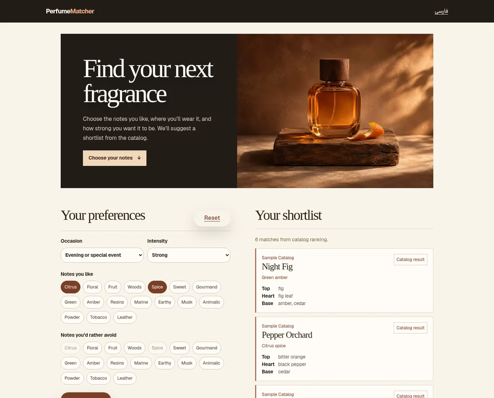

# PerfumeMatcher

A fragrance recommendation kiosk built for a perfume shop. Visitors answer a short questionnaire and get a shortlist they can explore by scent family and notes.

The application includes the original Persian kiosk and an English fragrance finder. Both use the Django recommendation service. The base engine ranks the catalog with TF-IDF and preference rules. You can optionally configure OpenAI to rerank the shortlist and return brief explanations.



## Run locally

You’ll need **Python 3.12+** and **Node.js 22**. The fixture contains 12 fictional fragrances and works without an OpenAI key. Use a fresh local database for the fixture.

**Backend**

```bash
python3.12 -m venv .venv
source .venv/bin/activate
pip install -r backend/requirements.txt
cd backend
SQLITE_PATH=db/local-sample.sqlite3 python manage.py migrate
SQLITE_PATH=db/local-sample.sqlite3 python manage.py loaddata sample_catalog
SQLITE_PATH=db/local-sample.sqlite3 python manage.py runserver 127.0.0.1:8000
```

**Frontend** (in another terminal, from the repository root)

```bash
cd frontend
npm ci
NEXT_PUBLIC_BACKEND_BASE_URL=http://127.0.0.1:8000 npm run dev
```

Open [the English fragrance finder](http://localhost:3000/en) or [the original Persian kiosk](http://localhost:3000). Try **Evening or special event**, **Strong**, and **Spice**.

## How it works

1. **Next.js** collects preferences and sends the same questionnaire format from the two interfaces.
2. **Django and scikit-learn** turn notes and preferences into weighted features and rank fragrances by similarity.
3. The **optional reranker** receives only the candidates and preferences needed for ranking. If the reranker is unavailable, the application can serve the base rankings.

`frontend/` contains the kiosk and admin UI. `backend/` contains the Django API, matching code and sample catalog. The repository includes a [deployment guide](DEPLOYMENT.md) for the original application.

## Checks

```bash
(cd frontend && npm run test -- --run && npm run build)
(cd backend && ../.venv/bin/python manage.py test api)
```

The English page’s product photograph is generated artwork. The code is [MIT licensed](LICENSE).
